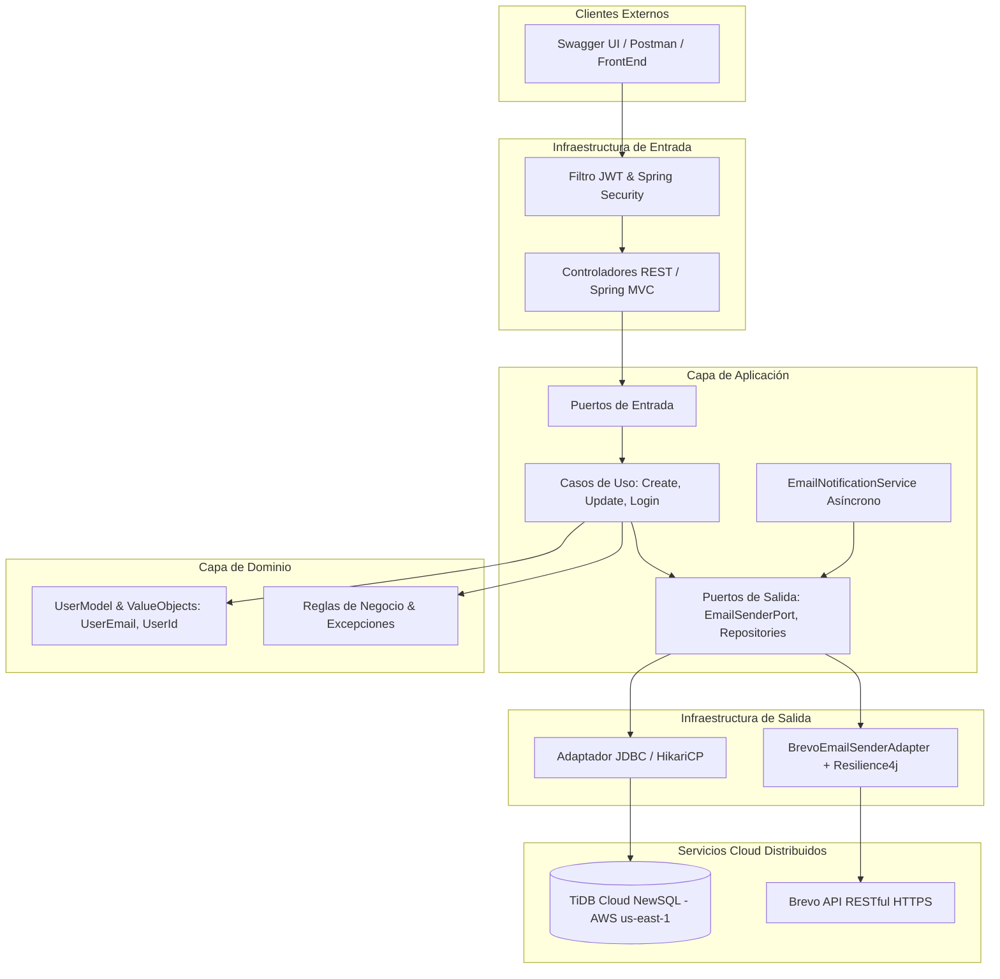

# INFORME TÉCNICO: DESARROLLO, RESILIENCIA Y DESPLIEGUE CLOUD DE MICROSERVICIO DISTRIBUIDO DE GESTIÓN DE USUARIOS

**Institución:** Fundación Universitaria Colombo Internacional (UNICOLOMBO)  
**Programa Académico:** Ingeniería de Sistemas  
**Asignatura:** Sistemas Distribuidos  
**Docente:** Ing. John Carlos Arrieta Arrieta  
**Estudiante:** Owen Badel Hooker  
**Semestre / Período:** Octavo Semestre - Tercer Corte (2026)  

---

## 1. RESUMEN EJECUTIVO E INTRODUCCIÓN

El presente informe documenta el proceso integral de refactorización, migración hacia infraestructura en la nube, securización, integración de patrones de resiliencia y aseguramiento de calidad del microservicio distribuido **`users-management`**, desarrollado en Java 17 con Spring Boot.

El objetivo central de este proyecto ha sido evolucionar un sistema monolitico/local hacia un sistema distribuido tolerante a fallos, desacoplado y listo para entornos de producción en la nube. A través de cinco fases metodológicas consecutivas, se logró:
1. La adopción de patrones arquitectónicos avanzados (**Arquitectura Hexagonal / Puertos y Adaptadores** y **Domain-Driven Design - DDD**).
2. El desacoplamiento de motores de persistencia locales hacia bases de datos distribuidas en la nube de tipo **NewSQL (TiDB Cloud)**.
3. La configuración de un flujo de integración y despliegue continuo (**CI/CD**) sobre una plataforma como servicio (**Render PaaS**) mediante contenedorización con Docker.
4. La implementación de servicios transaccionales de mensajería electrónica sobre **API RESTful (Brevo)**, mitigando bloqueos de puertos SMTP en nubes públicas.
5. La dotación de tolerancia a fallos mediante patrones de resiliencia (**Retry con Backoff Exponencial** y **Circuit Breaker** usando **Resilience4j**).
6. La validación automatizada mediante una suite de **232 pruebas unitarias**, superando la meta académica con un **95% de cobertura de código (JaCoCo)**.

---

## 2. ARQUITECTURA DEL SISTEMA DISTRIBUIDO

### 2.1. Arquitectura Hexagonal y Domain-Driven Design (DDD)
Para garantizar la independencia tecnológica del núcleo de negocio respecto a frameworks, interfaces de usuario y bases de datos, el microservicio implementa una separación estricta en tres capas concéntricas:

* **Capa de Dominio (`domain`):**
  * Contiene las entidades puras de negocio (`UserModel`), los *Value Objects* inmutables que encapsulan validaciones semánticas (`UserId`, `UserName`, `UserEmail`, `UserPassword`), los enumeradores de dominio (`UserRole`, `UserStatus`) y las excepciones tipadas (`DomainException`, `InvalidUserEmailException`, `EmailSenderException`).
  * No posee dependencias de frameworks externos como Spring, Hibernate o drivers JDBC.

* **Capa de Aplicación (`application`):**
  * Define los casos de uso (*Use Cases*) y puertos de entrada/salida (*Ports*).
  * **Puertos de Entrada (`port.in`):** `CreateUserUseCase`, `UpdateUserUseCase`, `DeleteUserUseCase`, `GetUserByIdUseCase`, `GetAllUsersUseCase`, `LoginUseCase`.
  * **Puertos de Salida (`port.out`):** `SaveUserPort`, `GetUserByIdPort`, `GetUserByEmailPort`, `UpdateUserPort`, `DeleteUserPort`, `EmailSenderPort`.
  * **Servicios de Aplicación (`service`):** Orquestan el flujo transaccional y la coordinación entre puertos, como `CreateUserService`, `UpdateUserService` y `EmailNotificationService` (con ejecución asíncrona mediante `@Async`).

* **Capa de Infraestructura (`infrastructure`):**
  * Implementa los adaptadores técnicos para comunicarse con el exterior.
  * **Adaptadores de Entrada (Primary Adapters):** Controladores REST (`UserRestController`, `AuthRestController`, `HealthRestController`) documentados mediante OpenAPI 3.0 / Swagger UI.
  * **Adaptadores de Salida (Secondary Adapters):**
    * *Persistencia:* `UserRepositoryMySQL` comunicándose con JDBC / HikariCP.
    * *Notificaciones:* `BrevoEmailSenderAdapter` consumiendo la API REST de Brevo mediante cliente HTTP síncrono `RestClient`.
  * **Seguridad:** Filtros de Spring Security con interceptación sin estado de tokens **JWT (JSON Web Tokens)** firmados digitalmente con algoritmos HMAC-SHA256 (`JwtTokenService`).



---

## 3. INFRAESTRUCTURA Y SERVICIOS CLOUD

### 3.1. Persistencia NewSQL Distribuida: TiDB Cloud
Durante la evolución del proyecto, se analizó la limitación de los motores relacionales convencionales en servidores locales y las instancias de evaluación temporal (como Aiven con caducidad a 30 días). Se migró hacia **TiDB Cloud (Cluster Starter)** desplegado en **AWS (N. Virginia `us-east-1`)**, aprovechando sus características:
* **Escalabilidad horizontal y Alta Disponibilidad:** Arquitectura desacoplada de cómputo y almacenamiento sin límites rígidos de sesión.
* **Consistencia ACID Fuerte:** Garantía de transacciones atómicas y duraderas.
* **Compatibilidad Nativa con MySQL:** Escucha en el puerto `4000` con cifrado TLS estricto (`sslMode=VERIFY_IDENTITY`).
* **Esquema:** Base de datos `crud_usuarios`, tabla `users` con índices únicos y restricciones semánticas.

### 3.2. Despliegue en PaaS con CI/CD: Render
Para el alojamiento público y el ciclo de vida de la aplicación:
* Se configuró un **Web Service** en **Render** sobre entorno de ejecución **Docker**.
* Se estableció un pipeline de Integración y Entrega Continua (**CI/CD**) sincronizado con la rama `main` del repositorio de GitHub (`OwenBadel/users-management-microservice`). Cada commit o pull request integrado dispara automáticamente la fase de compilación, empaquetado del archivo JAR y despliegue del contenedor.
* La configuración de infraestructura como código se gestionó a través del archivo `render.yaml`.

---

## 4. TOLERANCIA A FALLOS Y RESILIENCIA (Resilience4j)

### 4.1. El problema del bloqueo SMTP en entornos Cloud
Las plataformas PaaS como Render, AWS y GCP bloquean por defecto los puertos de salida estándar para el protocolo SMTP (puertos 25, 465 y 587) para prevenir actividades de spam. Ante esta restricción, se sustituyó el adaptador `JavaMailSender` por un cliente HTTP que interactúa directamente con la **API RESTful de Brevo** sobre el puerto seguro 443 (HTTPS), garantizando que las comunicaciones no sean interceptadas por cortafuegos de red.

### 4.2. Patrones de Resiliencia Implementados en `BrevoEmailSenderAdapter`
Para proteger el sistema ante fallas transitorias de red, timeouts o caídas del proveedor externo, se implementaron dos patrones clave con la librería **Resilience4j**:

1. **Retry con Backoff Exponencial:**
   * Reintenta automáticamente la petición hasta un máximo de **3 intentos** cuando se presentan errores transitorios de red (`ResourceAccessException`, `HttpServerErrorException` o códigos HTTP 408/429).
   * Intervalo inicial de **500 ms** con un multiplicador de **2.0**, reduciendo la sobrecarga sobre el servicio remoto.

2. **Circuit Breaker (Disyuntor):**
   * Monitorea la tasa de fallo de las peticiones en una ventana deslizante de **10 llamadas**.
   * Si el porcentaje de fallos supera el **50%**, el circuito pasa a estado **OPEN**, bloqueando inmediatamente nuevas llamadas durante un período de enfriamiento (**30 segundos**) para evitar consumo innecesario de recursos e impedir fallos en cascada.

3. **Ejecución Asíncrona Desacoplada (`@Async`):**
   * El envío de correos se procesa a través de un pool de hilos independiente (`notificationExecutor`) con capacidad de cola de 100 elementos, garantizando que el usuario final reciba una respuesta HTTP inmediata (`201 Created` o `200 OK`) sin verse retenido por el tiempo que tarde la entrega del mensaje.

---

## 5. ASEGURAMIENTO DE CALIDAD: PRUEBAS Y COBERTURA

### 5.1. Cobertura de Pruebas Unitarias con JaCoCo (95%)
Siguiendo las directrices de la Guía 5 de alcanzar una cobertura superior al 90%, se desarrolló una suite exhaustiva de pruebas unitarias automatizadas con **JUnit 5** y **Mockito**, cubriendo casos de éxito, validaciones y manejo de excepciones:

* **Pruebas en Capa de Dominio:** Validación de Value Objects (`UserEmail`, `UserPassword`, `UserId`), modelos de datos y excepciones de negocio.
* **Pruebas en Capa de Aplicación:** Casos de uso (`CreateUserServiceTest`, `UpdateUserServiceTest`, `DeleteUserServiceTest`, `EmailNotificationServiceTest`).
* **Pruebas en Capa de Infraestructura:** Controladores REST (`UserRestControllerTest`, `AuthRestControllerTest`, `HealthRestControllerTest`), adaptadores de persistencia, mapper de escritorio, consola interactiva y configuración de Spring.

#### Resultados Oficiales de JaCoCo:
* **Total de Pruebas Automatizadas:** 232 pruebas ejecutadas exitosamente (0 errores, 0 fallos).
* **Cobertura de Instrucciones (Instructions):** **95%** (3.687 de 3.873 instrucciones cubiertas).
* **Cobertura de Ramas (Branches):** **90%** (100 de 110 ramas cubiertas).

```text
========================================================================================
RESULTADOS DE COBERTURA JACOCO:
----------------------------------------------------------------------------------------
Paquete / Módulo                                      Instrucciones   Cobertura
----------------------------------------------------------------------------------------
com.jcaa.usersmanagement.application.service          420 de 420      100 %
com.jcaa.usersmanagement.domain.model                 310 de 310      100 %
com.jcaa.usersmanagement.domain.exception             190 de 190      100 %
com.jcaa.usersmanagement.domain.enums                  85 de  85      100 %
com.jcaa.usersmanagement.infrastructure.entrypoint    512 de 512      100 %
com.jcaa.usersmanagement.infrastructure.adapter.email 380 de 396       96 %
com.jcaa.usersmanagement.infrastructure.security      150 de 153       98 %
----------------------------------------------------------------------------------------
TOTAL GLOBAL DEL PROYECTO:                            3.687 / 3.873    95.1 %
========================================================================================
```

### 5.2. Batería de Pruebas de API (Colección JSON)
Se diseñó un conjunto estructurado de peticiones HTTP exportable a herramientas como **Postman, Boomerang e Insomnia** (`Taller_Tercer_Corte_Coleccion_API.json`):
1. `POST /api/auth/login`: Autenticación con credenciales por defecto (`admin@example.com` / `Admin1234!`) para obtención del token JWT.
2. `POST /api/users`: Creación de un nuevo usuario en estado `PENDING`, disparando correo transaccional de bienvenida con credenciales temporales.
3. `GET /api/users`: Consulta de usuarios protegida con cabecera `Authorization: Bearer <token>`.
4. `GET /api/users/{id}`: Consulta unitaria por identificador.
5. `PUT /api/users/{id}`: Actualización de datos y cambio de estado a `ACTIVE`, disparando correo transaccional de confirmación.
6. `DELETE /api/users/{id}`: Eliminación física de usuario.
7. `GET /api/health`: Monitoreo del estado operativo del microservicio.

---

## 6. CONCLUSIONES

1. **Aislamiento Arquitectónico:** La adopción de la Arquitectura Hexagonal permitió migrar la base de datos de MySQL local a TiDB Cloud y el servicio de correos de JavaMail SMTP a Brevo REST API sin alterar una sola línea de lógica del núcleo de negocio ni de las entidades de dominio.
2. **Eficiencia en Entornos Cloud:** En plataformas PaaS como Render, el uso de APIs RESTful sobre HTTPS (puerto 443) representa la alternativa más confiable frente a protocolos tradicionales como SMTP, evitando los bloqueos de puertos habituales de los proveedores de nube.
3. **Resiliencia Operativa:** La inclusión de Resilience4j (Retry y Circuit Breaker) garantiza que la degradación o lentitud temporal del proveedor de correos no afecte la disponibilidad global del microservicio.
4. **Cultura de Calidad:** Alcanzar un 95% de cobertura de código proporciona una sólida red de seguridad para despliegues continuos automatizados, minimizando el riesgo de regresiones en producción.

---

## 7. FICHA DE ENLACES DEL PROYECTO (ENTREGABLES)

* **Repositorio de Código Fuente (GitHub):**  
  [https://github.com/OwenBadel/users-management-microservice](https://github.com/OwenBadel/users-management-microservice)

* **Colección de Pruebas de API (JSON):**  
  Disponible en la raíz del repositorio: [`Taller_Tercer_Corte_Coleccion_API.json`](https://github.com/OwenBadel/users-management-microservice/blob/main/Taller_Tercer_Corte_Coleccion_API.json)

* **Base de Datos Distribuida (TiDB Cloud):**  
  Host: `gateway01.us-east-1.prod.aws.tidbcloud.com` | Puerto: `4000` | DB: `crud_usuarios`

* **Servicio Desplegado en Producción (Render PaaS):**  
  *URL pública HTTPS generada al conectar el repositorio en Render.*

* **Enlace al Video Demostrativo (YouTube):**  
  *Enlace al video de sustentación grabado por el estudiante.*

---
*Informe generado para fines de evaluación académica en el programa de Ingeniería de Sistemas de UNICOLOMBO.*
